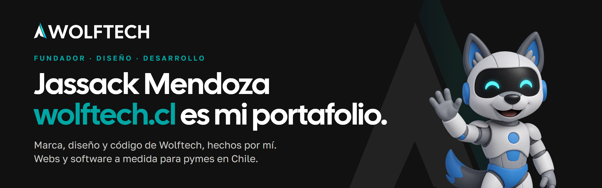
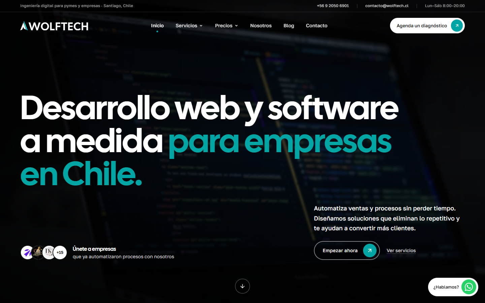

## Hola, soy Jassack

Fundador de **[Wolftech](https://www.wolftech.cl)**, estudio de desarrollo web y software a medida para pymes y empresas en Chile.

Todo lo que ves en **wolftech.cl** lo hice yo: la marca, el logo, el manual de identidad, el diseño del sitio, el código y los sistemas que entregamos a clientes. Por eso es mi portafolio.

  
  
  

## Qué hago

| Área | Detalle |
| --- | --- |
| **Marca e identidad** | Logo, isotipo, tipografías, paleta, manual de marca, papelería, tarjetas y kit para redes. |
| **Diseño web** | Sitios corporativos y landing pages orientadas a conversión, con SEO técnico desde el inicio. |
| **Desarrollo web** | Sitios rápidos en Astro y React, con Lighthouse 95+ como estándar. |
| **Software a medida** | Cotizaciones, agendamiento, inventario, CRM y portales de clientes. |
| **Sistemas integrados** | Varias áreas de una empresa conectadas en una sola plataforma, con roles y paneles de control. |
| **Contenido** | Posts, carruseles y reels de Wolftech, diseñados y animados con código. |

## Proyectos

**[wolftech.cl](https://www.wolftech.cl)**: marca, diseño y desarrollo del sitio completo (Astro, React, Tailwind CSS, Vercel).

### Entregados

| Cliente | Proyecto |
| --- | --- |
| **Hechobolsa.cl** | Sistema de cotizaciones y sitio web público conectados: las solicitudes llegan directo desde la web al sistema. |
| **dmfragns.cl** | Sitio web y sistema interno: ganancias, ventas, productos y stock en un solo lugar. |
| **MendozaMAQ** | App web para generar cotizaciones sin depender de Excel. |
| **OLS Estudio Jurídico** | Sitio web para estudio jurídico. |
| **Kotuupsd** | Auditoría tecnológica. |
| **Chicanos RP** | Desarrollo para servidor de videojuegos. |
| **RennitGO** | Sitio web (proyecto de hace años, hoy inactivo). |

### En desarrollo

- **Agencia Sazón**: sitio web B2B.
- **App para gimnasio**.
- **Plataforma de seguridad ciudadana**.

Los testimonios de los clientes están en [wolftech.cl](https://www.wolftech.cl).

## Stack

  
  
  
  
  
  
  
  
  

## Contacto

¿Necesitas una web, un sistema o una marca? Escríbeme a **contacto@wolftech.cl** o visita **[wolftech.cl](https://www.wolftech.cl)**.
